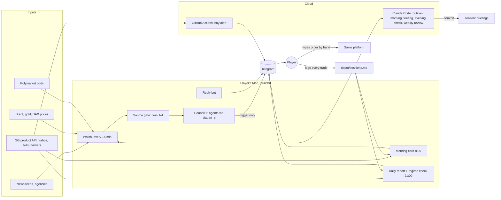

# Trader 2026

A research and decision-support system for **Trader 2026**, Société Générale's online trading
game, which ran for eight weeks (7 Sep to 30 Oct 2026, play money). It was built for one player,
a student who played next to full-time studies. The game does not allow automated trading, so the work was split: AI did
the research and the arithmetic, the player made every decision and typed every order by hand.
The system simulated the tournament to find a strategy that could win at all, watched the news
every 15 minutes, had five AI agents cross-check every headline, and sent finished order cards to
the player's phone. The code and documents were written with
[Claude Code](https://claude.com/claude-code).

**Result: Depot A more than doubled (over +100 % from €100,000), top 1 % out of 23,982 participants.**

| Depot A | |
|---|---|
| Start, 7 Sep | €100,000 |
| End, 30 Oct | more than doubled (over +100 %) |
| Final rank | **top 1 %** out of 23,982 participants |
| Positions | 11: 9 wins, 1 loss, 1 without a recorded outcome |
| Best trade | Brent BEST turbo call, bought at €1.38, sold three days later at €5.59 (+305 %, +€60,991) |
| Knock-outs | 1, on 16 Sep |

Every player had two depots and only the better one was ranked. This README covers Depot A, the
depot that set the rank. All of its trades are listed under [Every trade](#every-trade).

## How AI was used, and where it stopped

Rule 10 of the game (translated): "Prohibited: manipulative behaviour, multiple user names, and
unauthorised aids (for example automated trading systems)." A violation or a justified suspicion
leads to exclusion without a hearing.

The rules give no definition of "unauthorised aids" beyond that example. We read it as a ban on
anything that trades for the player and drew the line at who triggers the order: research,
screeners and calculators are aids every player uses, a script connected to the depot is not.

| AI | The player |
|---|---|
| simulated the tournament and proposed the strategy | chose the strategy, and changed it on 17 Sep |
| read the news every 15 minutes, rated each source, ran the five-agent Council | decided whether an alert called for action |
| found the SG turbo and computed WKN, limit and units for each order card | typed every order on the game platform |
| wrote the daily briefings and weekly reviews | set the platform's own stop-loss and limit orders |
| answered questions over Telegram | logged every trade in [`depot/positions.md`](depot/positions.md) |

The system never had a login to the game, never opened the game website and never placed,
changed or cancelled an order. Its output was always a message. The platform's stop-loss and
limit orders were the only automatic exits.

## Built around a student's schedule

The player studied full time and could not watch prices during the day. High-frequency or
intraday screen trading was never an option, so the system was built for a few well-prepared
decisions instead:

- **Few positions, held for hours to days.** 11 positions in eight weeks, fewer than two a week.
  Each arrived as a finished order card with WKN, limit and units, so the player only had to
  check it and type it in.
- **The exit decided at entry.** Each order card named the exit along with the buy: a sell limit
  placed as a platform order, or a fixed sell time for a day bet. An open position did not need
  watching.
- **Silent unless something happened.** The Watch looked every 15 minutes but wrote only on a
  trigger: a knock-out, a Brent move of 3 %, a Hormuz headline. Each message fit on a phone
  screen: what it means for the depot, what to do, one sentence why.
- **Fixed times.** The order card at 8:05, the daily report at 21:00 on weekdays, the weekly
  review on Sundays.

## The strategy

### Why leverage, and why one position

`src/tournament.py` simulates the whole field (about 30,000 players with two depots each),
calibrated to the 2025 game, where the winner reached €1.35M (13.5×). 250,000 simulated
seasons:

| Strategy | P(≥ €1.35M) | Median | P(> €500k) |
|---|---:|---:|---:|
| passive, diversified | **0.000 %** | 106,668 | 0.0 % |
| 4 high-volatility stocks, no leverage | **0.000 %** | 110,817 | 0.0 % |
| leverage, no reset, no locking in | 1.919 % | 206,517 | 22.4 % |
| leverage + resets | **2.774 %** | 382,598 | 37.1 % |
| leverage + resets + lock in from 250k | 0.000 % | 299,375 | 1.3 % |

Without a leveraged product first place is unreachable, because the 20 % position limit caps
every stock. With leverage the binding limit is €20,000 per depot in derivatives, so the only
path to a million is one position that grows past the limit after purchase. Taking profits at
3× cuts the chance of the winning mark from 2.70 % to 0.029 % (factor 93): after a sale only
€20,000 may go back in, so gains add instead of compound. Details and abort conditions:
[`strategy/00-thesis.md`](strategy/00-thesis.md).

### Phase 1, 7 to 16 Sep: one turbo held toward the winning mark

- **Underlying: Brent crude.** The Strait of Hormuz had been closed for 188 days when the game
  started, and oil moved more than anything else the system tracked.
- **One SG BEST turbo**, €20,000, as close to the barrier as SG offered (about 1.5 to 2.5 %).
  Turbos carry no volatility premium, which mattered with oil volatility at war levels
  ([`strategy/20-instruments.md`](strategy/20-instruments.md)).
- **No profit-taking below €500,000.** A sell limit at the winning mark (67.5 × entry) went in
  with the buy.
- **After a knock-out, re-enter at once**, and reset the depot when it is below €100,000.
- **Abort conditions fixed in advance**: a reported Hormuz agreement closes the long position,
  three knock-outs in a row switch from turbos to warrants, below €300,000 after week 5 the main
  prize is written off. Full list in [`strategy/00-thesis.md`](strategy/00-thesis.md).

Outcome: the Brent call FG6GK5 went from €1.38 to €5.59 in three days (+305 %) and was sold to
re-enter closer to the barrier. The next Brent call, FG6MRT, was bought on 15 Sep about 2.5 %
above its barrier and knocked out by a two-hour dip the next day. Depot A stood at €141,455 on
16 Sep.

### Phase 2, 17 Sep to 30 Oct: day bets that took every gain

On 17 Sep the player wrote off the main prize and ran Depot A as single bets out of cash:

- The player chose the bet the evening before ([`depot/examples/bet.json`](depot/examples/bet.json)
  shows the format); the 8:05 morning card turned it into WKN, limit and units.
- Brent calls about 5 % from the barrier, held two to four days; AMD calls at 2.5 to 5.3 %;
  earnings bets on Tesla (9.6 %) and Seagate (11.7 %).
- Every gain was taken. From mid-October a buy alert in GitHub Actions flagged pullback entries
  on Brent.

Outcome: all seven recorded bets after 17 Sep were profitable and none was knocked out. Depot A
grew from €141,455 to over €200,000. Each new bet was capped at €20,000 again, so the gains
added up instead of compounding, as the factor-93 calculation predicts. The final review calls it
a deliberate choice of a solid rank over a lottery tail.

### Rules for every order

- Game limits, checked with [`src/sizing.py`](src/sizing.py) before each order: at most €20,000
  and at most 20 % of the depot in leveraged products, at most 20,000 units, at most 20 % of the
  depot in any one security.
- Only a tier-1 source, or two independent tier-2 sources, could trigger an action. State media
  and social media could only raise a watch ([`strategy/90-sources.md`](strategy/90-sources.md)).

## Every trade

All 11 positions in Depot A, all SG BEST turbos. Net results include the €3.90 order fee on each
side.

| # | Held | Underlying | WKN | Type | Return | Net result |
|---:|---|---|---|---|---:|---:|
| 1 | 7 Sep, same day | Gold | FG6SFQ | put | +1.2 % | +€232 |
| 2 | 7–10 Sep | Brent | FG6GK5 | call | +305.1 % | +€60,991 |
| 3 | 15–16 Sep | Brent | FG6MRT | call | knock-out | −€19,764 |
| 4 | 17 Sep, ten minutes | Brent | FG6SKV | put | ~+7.1 % | ~+€1,400 |
| 5 | 17–18 Sep | AMD | not recorded [1] | call | not recorded | ~+€18,840 [2] |
| 6 | 21–24 Sep | AMD | FG7EGK | call | +91.6 % | +€17,662 |
| 7 | 24 Sep, sold by 5 Oct | AMD | FG7KMN | call | +138.4 % [2] | +€26,856 [2] |
| 8 | 5–9 Oct | Brent | FG7MXN | call | +58.1 % | +€11,322 |
| 9 | 12–14 Oct | Brent | FG8V8A | call | +41.3 % | +€8,179 |
| 10 | 21–26 Oct | Tesla | FG8GV8 | call | +34.5 % | +€6,751 |
| 11 | 27 Oct, order | Seagate | FE4E7Y | call | not recorded | not recorded [3] |

"~" marks figures the player gave as approximate.

1. The order card recommended FG7EES; units, prices and the number of intraday round trips were
   not recorded.
2. Derived from the cash balances, because the sale was not logged.
3. The fill and the exit were never recorded.

Entry and exit prices, the reason for each trade and the cash reconciliation are in
[`season/README.md`](season/README.md) and [`depot/positions.md`](depot/positions.md).

## How it worked



| Component | What it does |
|---|---|
| [`src/watch.py`](src/watch.py) | Every 15 minutes, 8:00–22:00 Berlin. Messages only on triggers: a Hormuz/Iran headline with an action word, a Polymarket jump of 5+ points, Brent ±3 %, a knock-out, a COT swing on Fridays. Otherwise silent. |
| [`src/sources.py`](src/sources.py) | Source register with four tiers. Action needs tier 1 or two independent tier-2 sources; everything else is downgraded to "watch". |
| [`src/council.py`](src/council.py) | Five specialist agents (maritime, diplomacy, oil market, auditor, depot) assess each item independently, then read each other's verdicts and respond, up to three rounds, until they agree on ABORT and ACTION. Without agreement the cautious verdict wins and the dissent is in the message. |
| [`src/morning_card.py`](src/morning_card.py) | The order card at 8:05: which SG turbo, units, limit, barrier distance, for every depot without a live position, or for the day bet the player set the evening before. |
| [`src/daily_report.py`](src/daily_report.py), [`src/regime.py`](src/regime.py) | Depot value from cash plus units × SG bid, distance to barriers; is Brent moving sideways and are gains on pace for the main prize. |
| [`src/buy_alert.py`](src/buy_alert.py) | Runs in GitHub Actions because the MacBook slept during the day. Sends "buy now, WKN, limit, units" when Brent reaches a pullback level. |
| [`src/reply_bot.py`](src/reply_bot.py) | Answers the player's Telegram questions with the repo as context. |
| [`src/sizing.py`](src/sizing.py) | Rule calculator, run before every order. |
| [`ops/routines/`](ops/routines/) | Prompts of the three cloud routines that wrote the daily briefings and weekly reviews. |
| [`CLAUDE.md`](CLAUDE.md) | The instructions every agent read first. |

The messages followed one format, set by the player in the first week: the assessment for the
depot first, two or three plain sentences of reasoning, nothing else, readable on a phone
without scrolling.

## What the season showed

- **The topic held.** The Strait of Hormuz stayed closed for all eight weeks and Brent went
  from about $96 to $115–117, more movement than any other underlying the system tracked.
- **Wider barriers survived.** The only knock-out, FG6MRT, was bought about 2.5 % above its
  barrier and lost to a two-hour dip the next day. Later bets were held for hours to days and
  mostly used wider barriers (about 5 % on the Brent calls, 9.6 % on the Tesla call); none was
  knocked out.
- **A 15-minute check misses intraday lows.** The Watch did not report the knock-out of
  16 Sep because it compared the current price, not the low since its last run. It was changed
  to track the low and high between runs.
- **The system was only as current as the positions file.** The cloud routines read a log that
  lagged the real trades; two weekly reviews reasoned from about €141k while Depot A held
  €206k and €218k.
- **Infrastructure limits shaped the design.** The MacBook slept during the day, so the buy
  alert moved to GitHub Actions. The cloud egress proxy blocked Telegram, so routines reported
  by committing to the repo. The browser round was retired over security concerns.

## Repo map

| Path | Contents |
|---|---|
| `src/` | all modules, each runnable on its own (`python3 src/<name>.py --help`) |
| `tests/` | unit tests for rule math, parsers, state files, message format, reports (no network, no model calls) |
| `strategy/` | thesis, rules, instruments, calendar, Hormuz dossier, source register, Council design, research; [index](strategy/README.md) |
| `season/` | the season record: trades, weekly reviews, final review, sample briefings; [overview](season/README.md) |
| `depot/positions.md` | the positions file the player kept and every component read |
| `ops/` | launchd templates, cloud routine prompts, the buy-alert workflow |

## Running it

Python 3.12+, numpy for the simulations. No API keys are needed for the tests or the
simulations.

```bash
pip install -r requirements.txt
python3 -m unittest discover -s tests          # rule math, parsers, message format
python3 src/tournament.py                      # the tournament simulation
python3 src/knockout_window.py                 # BEST vs X-BEST turbo survival
python3 src/sizing.py 100000 --ask 2.50 --leveraged
python3 src/watch.py --test --ignore-quiet-hours   # one Watch pass, prints instead of sending
```

The Watch, the Council and the reply bot call the `claude` CLI and need it installed and logged
in. Telegram needs a bot token and chat ID in `.env` (see `.env.example`). The live jobs are
described in [`ops/launchd/`](ops/launchd/); everything was paused on 11 Nov 2026 after the
game ended.

## Notes

- Play money only. Nothing here is investment advice, and the system makes no direction
  forecasts: historical data gives the size of a move, not its sign.
- Not affiliated with Société Générale. Product WKNs and prices are from SG's public product
  pages and API during the season.
- A browser-based research round (X, UKMTO, Reddit through a logged-in browser) ran until
  22 Oct 2026 and was then retired for security reasons; the code is kept in
  [`src/browser_round.py`](src/browser_round.py) for reference and does not run by default.
- No credentials or logins are in this repository: no API keys, tokens, account names or session
  data. The original working repos are private and in German; this is a cleaned English edition
  with a fresh history.
