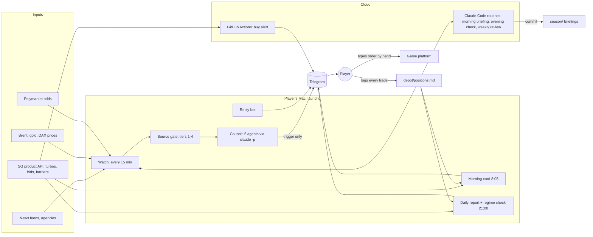

# Trader 2026

A research and decision-support system built with [Claude Code](https://claude.com/claude-code)
for **Trader 2026**, Société Générale's online trading game (7 Sep to 30 Oct 2026, play
money). It simulated the tournament to find a strategy that could win at all, watched the news
every 15 minutes, had five AI agents cross-check every headline, and sent finished orders to
the player's phone. Every order was typed by hand: the game bans automated trading.

**Result: Depot A more than doubled (over +100 % from €100,000), top 1 % out of 23,982 participants.**

| | Depot A | Depot B |
|---|---:|---:|
| Start | €100,000 | €100,000 |
| End (30 Oct) | more than doubled (over +100 %) | €81,846.60 (−18.2 %, idle from 15 Sep) |
| Final rank (better depot counts) | **top 1 %** out of 23,982 participants | |

14 positions over eight weeks, 10 wins and 3 losses with a recorded outcome. Best trade: a
Brent BEST turbo call bought at €1.38 and sold three days later at €5.59 (+305 %, +€60,991).
Three knock-outs, all in the first ten days. Full record: [`season/README.md`](season/README.md).

## The constraint that shaped everything

Rule 10 of the game bans automated trading systems; a violation or reasonable suspicion means
exclusion without a hearing. So the system has no access to the game account, never opens the
game website, and never places an order. Its output is always a message: WKN, limit, units,
validity. The player decided and typed. Platform-native stop-loss and limit orders are allowed
and were the only "automation" on the trading side.

## The math behind the strategy

`src/tournament.py` simulates the whole field (about 30,000 players with two depots each),
calibrated to the 2025 game, where the winner reached €1.35M (13.5×). 250,000 simulated
seasons:

| Strategy | P(≥ €1.35M) | Median | P(> €500k) |
|---|---:|---:|---:|
| passive, diversified | **0.000 %** | 106,668 | 0.0 % |
| 4 high-volatility stocks, no leverage | **0.000 %** | 110,817 | 0.0 % |
| leverage, no reset, no locking in | 1.919 % | 206,517 | 22.4 % |
| leverage + resets | **2.774 %** | 382,598 | 37.1 % |
| leverage + resets + lock in from 250k | 0.000 % | 299,375 | 1.3 % |

Without a leveraged product first place is unreachable, because the 20 % position limit caps
every stock. With leverage the binding limit is €20,000 per depot in derivatives, so the only
path to a million is one position that grows past the limit after purchase. Taking profits at
3× cuts the chance of the winning mark from 2.70 % to 0.029 % (factor 93): after a sale only
€20,000 may go back in, so gains add instead of compound. Details and abort conditions:
[`strategy/00-thesis.md`](strategy/00-thesis.md).

The plan: €20,000 in one turbo on Brent crude (the Strait of Hormuz had been closed for 188
days at the start of the game), hold, re-enter right after a knock-out, play the second depot
in the opposite direction. From 17 Sep the player chose day bets with profit-taking instead;
the season record shows how both played out.

## How it worked



| Component | What it does |
|---|---|
| [`src/watch.py`](src/watch.py) | Every 15 minutes, 8:00–22:00 Berlin. Messages only on triggers: a Hormuz/Iran headline with an action word, a Polymarket jump of 5+ points, Brent ±3 %, a knock-out, a COT swing on Fridays. Otherwise silent. |
| [`src/sources.py`](src/sources.py) | Source register with four tiers. Action needs tier 1 or two independent tier-2 sources; everything else is downgraded to "watch". |
| [`src/council.py`](src/council.py) | Five specialist agents (maritime, diplomacy, oil market, auditor, depot) assess each item independently, then read each other's verdicts and respond, up to three rounds, until they agree on ABORT and ACTION. Without agreement the cautious verdict wins and the dissent is in the message. |
| [`src/morning_card.py`](src/morning_card.py) | The order card at 8:05: which SG turbo, units, limit, barrier distance, for every depot without a live position, or for the day bet the player set the evening before. |
| [`src/daily_report.py`](src/daily_report.py), [`src/regime.py`](src/regime.py) | Depot value from cash plus units × SG bid, distance to barriers; is Brent moving sideways and are gains on pace for the main prize. |
| [`src/buy_alert.py`](src/buy_alert.py) | Runs in GitHub Actions because the MacBook slept during the day. Sends "buy now, WKN, limit, units" when Brent reaches a pullback level. |
| [`src/reply_bot.py`](src/reply_bot.py) | Answers the player's Telegram questions with the repo as context. |
| [`src/sizing.py`](src/sizing.py) | Rule calculator, run before every order. |
| [`ops/routines/`](ops/routines/) | Prompts of the three cloud routines that wrote the daily briefings and weekly reviews. |
| [`CLAUDE.md`](CLAUDE.md) | The instructions every agent read first. |

The messages followed one format, set by the player in the first week: the assessment for the
depots first, two or three plain sentences of reasoning, nothing else, readable on a phone
without scrolling.

## What the season showed

- **The topic held.** The Strait of Hormuz stayed closed for all eight weeks and Brent went
  from about $96 to $115–117, more movement than any other underlying the system tracked.
- **The factor-93 rule held in reverse.** From 17 Sep the player switched to day bets and took
  every profit. All seven recorded bets after that were profitable and none was knocked out,
  and Depot A grew to over €200,000 in that second half. Each new bet was capped at €20,000 again, so the
  gains added up instead of compounding, and the €1.35M winning mark was out of reach. The
  final review calls it a deliberate choice of a solid rank over a lottery tail.
- **Knock-outs clustered early.** All three came in the first ten days, at 1.5–2.5 % distance
  to the barrier on entry. Later bets were held for hours to days and mostly used wider
  barriers (about 5 % on the Brent calls, 9.6 % on the Tesla call); none was knocked out.
- **A 15-minute check misses intraday lows.** The Watch did not report the knock-out of
  16 Sep because it compared the current price, not the low since its last run. It was changed
  to track the low and high between runs.
- **The system was only as current as the positions file.** The cloud routines read a log that
  lagged the real trades; two weekly reviews reasoned from about €141k while Depot A held
  €206k and €218k.
- **Infrastructure limits shaped the design.** The MacBook slept during the day, so the buy
  alert moved to GitHub Actions. The cloud egress proxy blocked Telegram, so routines reported
  by committing to the repo. The browser round was retired over security concerns.
- **Untested:** running the two depots in opposite directions, which the simulation rated as
  the biggest lever (P(> €500k) 40 % → 56 %). Depot B was parked on 15 Sep.

## Repo map

| Path | Contents |
|---|---|
| `src/` | all modules, each runnable on its own (`python3 src/<name>.py --help`) |
| `tests/` | unit tests for rule math, parsers, state files, message format, reports (no network, no model calls) |
| `strategy/` | thesis, rules, instruments, calendar, Hormuz dossier, source register, Council design, research; [index](strategy/README.md) |
| `season/` | the season record: trades, weekly reviews, final review, sample briefings; [overview](season/README.md) |
| `depot/positions.md` | the positions file the player kept and every component read |
| `ops/` | launchd templates, cloud routine prompts, the buy-alert workflow |

## Running it

Python 3.12+, numpy for the simulations. No API keys are needed for the tests or the
simulations.

```bash
pip install -r requirements.txt
python3 -m unittest discover -s tests          # rule math, parsers, message format
python3 src/tournament.py                      # the tournament simulation
python3 src/knockout_window.py                 # BEST vs X-BEST turbo survival
python3 src/sizing.py 100000 --ask 2.50 --leveraged
python3 src/watch.py --test --ignore-quiet-hours   # one Watch pass, prints instead of sending
```

The Watch, the Council and the reply bot call the `claude` CLI and need it installed and logged
in. Telegram needs a bot token and chat ID in `.env` (see `.env.example`). The live jobs are
described in [`ops/launchd/`](ops/launchd/); everything was paused on 11 Nov 2026 after the
game ended.

## Notes

- Play money only. Nothing here is investment advice, and the system makes no direction
  forecasts: historical data gives the size of a move, not its sign.
- Not affiliated with Société Générale. Product WKNs and prices are from SG's public product
  pages and API during the season.
- A browser-based research round (X, UKMTO, Reddit through a logged-in browser) ran until
  22 Oct 2026 and was then retired for security reasons; the code is kept in
  [`src/browser_round.py`](src/browser_round.py) for reference and does not run by default.
- No credentials are in this repository. The original working repos are private and in German;
  this is a cleaned English edition with a fresh history.
